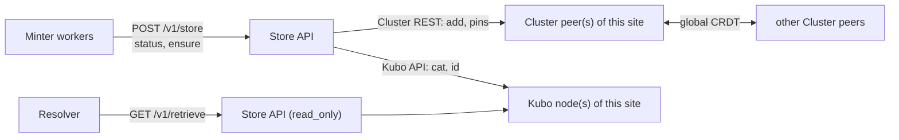

# Store API architecture

Store API is the storage boundary of dARK: a stateless FastAPI service in front of
a **failover pool** of Kubo (IPFS) and IPFS Cluster REST endpoints. The writer
connects to the inventory's declared storage peers; dedicated readers use
site-local peers when sites are declared.
Minter and Resolver never learn the IPFS topology. Cluster itself remains one
global CRDT cluster, so Store APIs never call each other.

## Module map

| Path | Role |
|---|---|
| `app/main.py` | App factory, lifespan (starts/closes the backend), router mounting |
| `app/api/store.py` | Endpoints under `/v1` and the health endpoints; `read_only` guard |
| `app/backends/base.py` | `StorageBackend` contract, `PinStatus`, `ReplicationInfo`, `ContentInfo`, `StorageError` |
| `app/backends/ipfs_cluster.py` | Production backend (`IPFSClusterBackend`) with `_EndpointPool` failover |
| `app/backends/filesystem.py` | Test-only backend; not a supported deployment |
| `app/topology.py` | `load_endpoints()` reads the generated endpoint document |
| `app/config.py`, `app/dependencies.py` | Settings and backend wiring |
| `app/models/responses.py` | `StoreResponse`, `StatusResponse`, `ReplicationResponse`, `BatchStatusResponse`, `HealthResponse`, `ErrorResponse` |

## Where it sits



A Store API may be shared by several stacks or dedicated to one; a Resolver can use
a read-only Store API placed next to it.

## Endpoint document

The deployer resolves the access group and mounts a generated
`/config/storage-endpoints.json` (`STORAGE_ENDPOINTS_FILE`) read-only. Store API
parses only this minimal document, not a site or peer map:

```json
{
  "version": 1,
  "nodes": [
    { "id": "storage-a",
      "ipfs_api_url": "http://<kubo-host>:5001",
      "cluster_api_url": "http://<cluster-host>:9094" }
  ]
}
```

Validation (`StorageTopologyError`): version must be `1`; `nodes` non-empty; each
node has a unique non-empty `id` and `http(s)` URLs for both endpoints. URLs are
stripped of trailing slashes and split into an `ipfs` pool and a `cluster` pool.

## Write path

1. `POST /v1/store` (raw bytes, any content type) → the backend posts the payload to
   a Cluster REST peer: `POST {cluster}/add?cid-version=1&pin=true&local=true&replication-min=1&replication-max=1&stream-channels=false`.
2. The first endpoint that accepts the add wins; the CID and size are returned
   **immediately**. `replication` in the response is `null`: acceptance is not
   availability.
3. Pin propagation is asynchronous. The Minter's replication worker observes it
   through `status` calls.

CIDv1 is always used. Failures: a timeout, refused connection, `429` or `5xx`
(`_retryable_status`) puts the endpoint in a 30-second cooldown and tries the next
one; a non-retryable HTTP error aborts as `StorageError`; if all endpoints fail,
`500`.

## Status model

`GET {cluster}/pins/{cid}` gives per-peer assignments. Store API reports:

| Field | Meaning |
|---|---|
| `total_replicas` | Peers whose assignment is confirmed `pinned` (the only count that matters for publication) |
| `queued_replicas`, `pinning_replicas` | Normal asynchronous progress |
| `error_replicas` | A real Cluster error |
| `assigned_replicas` | All peer assignments |
| `status` | `pinned`, `pinning`, `queued`, `unpinned`, `error`, `unknown` |

Health fails when several visible Cluster peers advertise the same Kubo peer
identity, since that would inflate HA replica counts. Batch status runs up to
200 CIDs concurrently (`STORE_STATUS_CONCURRENCY`); a timeout is reported for that
CID only.

## Durability promotion (`replication/ensure`)

`POST {cluster}/pins/{cid}?replication-min=T&replication-max=T` raises an existing
pin to `target_replicas` **without re-uploading**. The verdict per CID is
`promotion_requested`, `already_allocated` (also when the caller-supplied
`assigned_replicas` already meets the target, saving a Cluster call) or
`promotion_failed`. The call does not wait for the new pins. Concurrency is bounded
by `STORE_PROMOTION_CONCURRENCY`. Store API never unpins and never decides
publication or payload purge: that belongs to the Minter.

## Read path

`GET /v1/retrieve/{cid}` posts `{kubo}/api/v0/cat?arg={cid}` to the local Kubo pool
with the same failover; an unknown CID is `404`.

## Read-only mode

`STORE_API_MODE=read_only` makes `POST /v1/store` and `POST /v1/replication/ensure`
answer `403` **before** touching the backend; `/health` then means read readiness
and `/health/write` returns `503`. The boundary is in the API, not in the network.

## Concurrency and caching

Writes, status checks and promotions use bounded semaphores
(`STORE_ADD_CONCURRENCY` default 4, `STORE_STATUS_CONCURRENCY` 6,
`STORE_PROMOTION_CONCURRENCY` 4). Write-readiness is cached for
`IPFS_HEALTH_CACHE_TTL_SECONDS` (default 10 s); `refresh` bypasses it internally.
